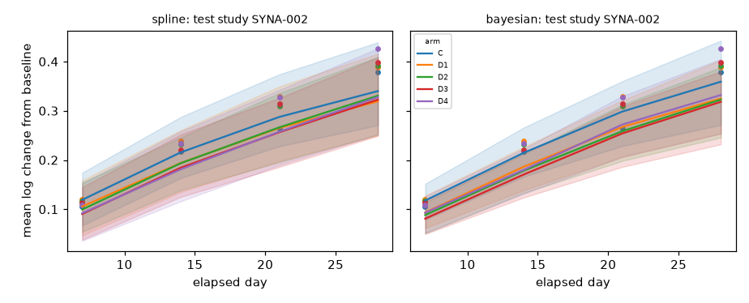
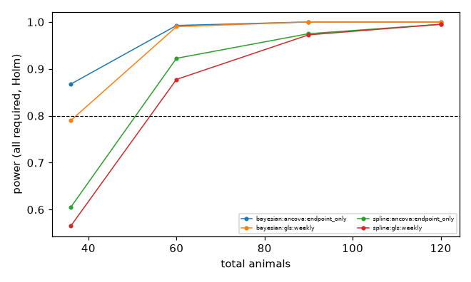

# send_bw report: bayesian_smoke

> **SYNTHETIC PROOF OF CONCEPT - NOT REAL-WORLD VALIDATION**

Body weight is the only modelled endpoint. Results cannot establish total animal requirements for a toxicology program, cannot justify reducing welfare observations or protocol checks, and are not regulatory-grade.

## Run provenance

- config: `configs/bayesian_smoke.yaml` (hash `f47e272c2e751999`), seed 20261017
- git revision: not available (git not installed / not a repo)
- software: arviz=1.3.0, matplotlib=3.11.2, numpy=2.5.4, nutpie=0.16.11, pandas=3.0.6, platform=Windows-11-10.0.26300-SP0, pyarrow=26.0.0, pydantic=2.14.1, pymc=6.3.2, pytensor=3.3.4, python=3.14.7, scikit-learn=1.9.1, scipy=1.18.1, torch=2.14.1+cpu

| stage | status | seconds | key |
|---|---|---|---|
| design | evaluated | 42.1 | NA |
| evaluate | NA | 13.6 | NA |
| generate | NA | 0.2 | de470559004a9279 |
| ingest | NA | 0.5 | 8423b63bfba03ea7 |
| optional_models | {'chronos2': 'not_run', 'deepar': 'not_run', 'tft': 'not_run'} | NA | NA |
| prepare | NA | 0.2 | 2a9ae4f9580b3692 |
| report | NA | NA | NA |
| train_bayesian | trained | 50.6 | 496a227b3b37e440 |
| train_spline | trained | 1.7 | 50050de1e7c86064 |

## Data ingestion and QC

- weights: 6479, animals: 826, quarantined/flagged records: 0, mapping version: example-send-0.1
- eligible animals: 775, modelling observations: 3941
- QC checks: {'all_obs_have_animal': True, 'arm_keys_resolved': True, 'finite_log_weights': True, 'n_quarantined_hard': 0, 'n_quarantined_soft': 0, 'one_baseline_per_animal_max': True, 'passed': True, 'positive_weights': True, 'sex_values': ['F', 'M'], 'unique_animal_keys': True, 'unique_obs_keys': True}

Exclusion counts (animals):

| reason | n |
|---|---|
| species_out_of_scope | 50 |
| too_few_post_baseline_obs | 1 |

Limitations recorded during ingestion:

- 3 weight(s) dated from SEND study day because BWDTC was partial (DATE_UNCERTAIN)
- 31 administration record(s) deviate from the planned regimen; models use planned regimens only, so outcomes include deviation effects

Mapping warnings by type: none

Frozen study-level splits: {'test': 3, 'test_compound_holdout': 1, 'train': 9, 'validation': 3} (hash `47b9e5e7daf20bb0`); compound holdout: ['CMP01']

## Models

### spline

- ridge alpha 100.0 (validation-selected), train RMSE 0.0466, validation RMSE 0.0506, OOF RMSE 0.0701, 62 mean parameters, 7 study-bootstrap members
- covariance (OOF residual ML): ell=5.7184, sd_a0=0.0272, sd_a1=0.0575, sd_s0=0.0311, sd_s1=0.0375, sigma_m=0.0069, sigma_p=0.0255
- covariance fit: {'converged': True, 'message': 'CONVERGENCE: RELATIVE REDUCTION OF F <= FACTR*EPSMCH', 'n_animals': 431, 'n_obs': 1845, 'n_studies': 9, 'nll': -3575.8651116777655, 'params_at_bound': []}

### transformer: not_run

### bayesian

- status: **RELIABLE (diagnostic targets met)**
- NUTS (4 chains, 2000 warmup, 2000 draws, seed 20261017): R-hat max 1.006, bulk ESS min 633, tail ESS min 963, divergences 0, max-treedepth hits 0; thresholds {'rhat_max': 1.01, 'ess_bulk_min': 400, 'ess_tail_min': 400}
- sampler warnings: none
- worst R-hat parameters: {'sigma_p': 1.0063754266284817, 'ell': 1.0056097565092188, 'sd_a[0]': 1.0043833706168621, 'theta[14]': 1.003719683516778, 'theta[38]': 1.0035465958573464}
- priors (on training-standardized scale): {'s_beta': 0.35, 's_sd': 0.3, 's_sigma': 0.3, 'm_ell': 1.9459101490553132, 's_ell': 0.75}
- prior predictive (pct change at last observation, 2.5/50/97.5%): [-44.7, 9.1, 115.5] vs observed [0.9, 31.9, 70.3]; grams [117, 246, 534]; plausible=True
- posterior predictive (one-step) p-values by time bin: {'<=7': {'p_mean': 0.451625, 'p_sd': 0.7715}, '8-14': {'p_mean': 0.463875, 'p_sd': 0.255625}, '15-21': {'p_mean': 0.5795, 'p_sd': 0.47675}, '22-28': {'p_mean': 0.448875, 'p_sd': 0.630875}}; extreme bins: []
- posterior means (log-weight scale): {'sd_s': [0.06876269301717608, 0.29219918287992686], 'sd_a': [0.1605319063615331, 0.33343214089745893], 'sigma_p': 0.16780337367113554, 'ell': 3.9778735982489466, 'sd_s_scaled_logw': [0.00933559546847874, 0.03967054296296469], 'sd_a_scaled_logw': [0.0217946806882714, 0.045268552568613715], 'sigma_p_scaled_logw': 0.022781894456175445}

Prior / likelihood / random-effect sensitivity (validation studies):

| variant | reliable | rhat_max | mean_pred_change_day28_validation | sd_s_logw | sd_a_logw | sigma_p_logw | ell |
|---|---|---|---|---|---|---|---|
| main | True | 1.0064 | 0.2941 | [0.0093, 0.0397] | [0.0218, 0.0453] | 0.0228 | 3.9779 |
| prior_scale_x0.5 | True | 1.0063 | 0.2938 | [0.0093, 0.0329] | [0.0220, 0.0442] | 0.0227 | 3.8868 |
| prior_scale_x2.0 | False | 1.0184 | 0.2946 | [0.0099, 0.0439] | [0.0216, 0.0458] | 0.0227 | 3.9632 |
| student_t | False | 1.0108 | 0.2939 | [0.0094, 0.0398] | [0.0226, 0.0456] | 0.0213 | 3.6544 |
| no_animal_intercept | False | 1.0214 | 0.2952 | [0.0096, 0.0406] | [0.0323, 0.0490] | 0.0280 | 7.9908 |

### Optional models (not required benchmarks)

| model | status | task | reason |
|---|---|---|---|
| chronos2 | not_run | secondary (early-history, zero-shot first; fine-tuning separate) | disabled in config |
| deepar | not_run | secondary (early-history forecasting) | disabled in config |
| tft | not_run | secondary (early-history forecasting) | disabled in config |

## Held-out evaluation

### Primary task: pre-study prediction of new studies

| model | split | studies | obs | RMSE log | RMSE g | MAE g | cov80 | cov95 | CRPS | SB RMSE | SB cov95 | energy | grp-mean cov90 | contrast cov90 | contrast bias | var ratio | incr ratio | max cov90 |
|---|---|---|---|---|---|---|---|---|---|---|---|---|---|---|---|---|---|---|
| bayesian | test_compound_holdout | 1 | 512 | 0.086 | 23.681 | 18.668 | 0.498 | 0.654 | 0.053 | 0.086 | 0.654 | 0.181 | 0.509 | 0.200 | -0.030 | 1.058 | 4.185 | 0.833 |
| bayesian | test | 3 | 573 | 0.072 | 23.369 | 16.934 | 0.660 | 0.859 | 0.040 | 0.073 | 0.828 | 0.087 | 0.688 | 0.667 | -0.027 | 1.077 | 0.976 | 0.767 |
| spline | test_compound_holdout | 1 | 512 | 0.044 | 11.971 | 8.911 | 0.934 | 0.992 | 0.026 | 0.044 | 0.992 | 0.080 | 1.000 | 1.000 | -0.007 | 1.232 | 1.053 | 0.955 |
| spline | test | 3 | 573 | 0.084 | 26.493 | 19.988 | 0.728 | 0.914 | 0.047 | 0.084 | 0.909 | 0.101 | 0.680 | 0.750 | 0.014 | 1.302 | 1.058 | 0.774 |

SB = study-balanced. Coverage targets: cov80=0.80, cov95=0.95, group-mean/contrast/max cov90=0.90; variance and increment ratios target 1. Few test studies -> wide uncertainty.

Residual correlation by gap (observed vs predicted):

| model | split | gap_bin | corr_obs | corr_pred | n_pairs |
|---|---|---|---|---|---|
| bayesian | test_compound_holdout | (0,4] | 0.920 | 0.922 | 7 |
| bayesian | test_compound_holdout | (4,8] | 0.885 | 0.877 | 6 |
| bayesian | test_compound_holdout | (8,15] | 0.800 | 0.817 | 9 |
| bayesian | test_compound_holdout | (15,100] | 0.681 | 0.718 | 6 |
| bayesian | test | (4,8] | 0.830 | 0.850 | 9 |
| bayesian | test | (8,15] | 0.772 | 0.777 | 6 |
| bayesian | test | (15,100] | 0.668 | 0.696 | 3 |
| spline | test_compound_holdout | (0,4] | 0.920 | 0.926 | 7 |
| spline | test_compound_holdout | (4,8] | 0.885 | 0.875 | 6 |
| spline | test_compound_holdout | (8,15] | 0.800 | 0.806 | 9 |
| spline | test_compound_holdout | (15,100] | 0.681 | 0.693 | 6 |
| spline | test | (4,8] | 0.830 | 0.864 | 9 |
| spline | test | (8,15] | 0.772 | 0.774 | 6 |
| spline | test | (15,100] | 0.668 | 0.662 | 3 |

### Secondary task: early-history forecasting (kept separate)

| model | split | status | rmse_log | cov90 | crps_log | n_obs | note |
|---|---|---|---|---|---|---|---|
| bayesian | test_compound_holdout | not_run | NA | NA | NA | NA | early-history conditioning not implemented for this model |
| bayesian | test | not_run | NA | NA | NA | NA | early-history conditioning not implemented for this model |
| spline | test_compound_holdout | conditioned | 0.035 | 0.946 | 0.019 | 259 | NA |
| spline | test_compound_holdout | pre_study | 0.052 | 0.985 | 0.030 | 259 | NA |
| spline | test | conditioned | 0.038 | 0.955 | 0.021 | 287 | NA |
| spline | test | pre_study | 0.100 | 0.801 | 0.058 | 287 | NA |

Success on the secondary task does not establish success on the primary task.

## Experimental design

- request validation: {'problems': [], 'status': 'supported', 'warnings': []}
- overall status: **evaluated**
- power = conditional power at the prespecified meaningful effects (Holm, all required); 'assurance' columns use model-predicted effects and are a separate quantity
- secondary estimand (GLS only): fixed weighted average of contrasts at the request's query times; reported for bias/coverage, not used for feasibility
- replicates: proposal 400, final 600 -> **low replication: nonconclusive software check**

> SYNTHETIC PROOF OF CONCEPT
> conditional power at prespecified effects is reported separately from predictive assurance under model-predicted effects
> Analytical schedule only; protocol-required welfare weighings and clinical observations are performed regardless and are not optimized.

### Proposal under bayesian

- feasible candidates 6/8; status feasible_found; finalists ['ancova|endpoint_only|n=6/6/6|equal', 'ancova|endpoint_only|n=10/10/10|equal']; comparator ancova|endpoint_only|n=6/6/6|equal
- effect-shape notes: model-predicted shapes
- model-predicted contrast at T (%): {'high': -14.64, 'low': -7.68}; synthetic oracle: {'high': -22.19, 'low': -15.53}

| candidate | n_animals | n_measurements | power | power_ci_lo | fwer_max_point | fwer_max_ci_hi | coverage_min | bias_frac | failure_rate_max | feasible | assurance_all_required_model_effect | secondary_coverage_min | secondary_bias_max_abs |
|---|---|---|---|---|---|---|---|---|---|---|---|---|---|
| ancova|endpoint_only|n=6/6/6|equal | 36 | 72 | 0.868 | 0.830 | 0.037 | 0.061 | 0.960 | 0.013 | 0.000 | True | 0.975 | NA | NA |
| gls|weekly|n=6/6/6|equal | 36 | 180 | 0.790 | 0.747 | 0.018 | 0.036 | 0.963 | 0.067 | 0.000 | False | 0.935 | 0.973 | 0.005 |
| ancova|endpoint_only|n=10/10/10|equal | 60 | 120 | 0.993 | 0.978 | 0.045 | 0.070 | 0.955 | 0.009 | 0.000 | True | 0.998 | NA | NA |
| gls|weekly|n=10/10/10|equal | 60 | 300 | 0.990 | 0.975 | 0.018 | 0.036 | 0.945 | 0.059 | 0.000 | True | 0.995 | 0.970 | 0.005 |
| ancova|endpoint_only|n=15/15/15|equal | 90 | 180 | 1.000 | 0.991 | 0.048 | 0.073 | 0.953 | 0.003 | 0.000 | True | 1.000 | NA | NA |
| gls|weekly|n=15/15/15|equal | 90 | 450 | 1.000 | 0.991 | 0.020 | 0.039 | 0.930 | 0.064 | 0.000 | True | 1.000 | 0.953 | 0.005 |
| ancova|endpoint_only|n=20/20/20|equal | 120 | 240 | 1.000 | 0.991 | 0.048 | 0.073 | 0.953 | 0.002 | 0.000 | True | 1.000 | NA | NA |
| gls|weekly|n=20/20/20|equal | 120 | 600 | 1.000 | 0.991 | 0.033 | 0.055 | 0.897 | 0.065 | 0.000 | False | 1.000 | 0.945 | 0.005 |

### Proposal under spline

- feasible candidates 6/8; status feasible_found; finalists ['ancova|endpoint_only|n=10/10/10|equal', 'gls|weekly|n=10/10/10|equal']; comparator ancova|endpoint_only|n=10/10/10|equal
- effect-shape notes: model-predicted shapes
- model-predicted contrast at T (%): {'high': -8.99, 'low': -3.39}; synthetic oracle: {'high': -22.19, 'low': -15.53}

| candidate | n_animals | n_measurements | power | power_ci_lo | fwer_max_point | fwer_max_ci_hi | coverage_min | bias_frac | failure_rate_max | feasible | assurance_all_required_model_effect | secondary_coverage_min | secondary_bias_max_abs |
|---|---|---|---|---|---|---|---|---|---|---|---|---|---|
| ancova|endpoint_only|n=6/6/6|equal | 36 | 72 | 0.605 | 0.555 | 0.050 | 0.076 | 0.945 | 0.035 | 0.000 | False | 0.412 | NA | NA |
| gls|weekly|n=6/6/6|equal | 36 | 180 | 0.565 | 0.515 | 0.037 | 0.061 | 0.943 | 0.110 | 0.000 | False | 0.388 | 0.948 | 0.008 |
| ancova|endpoint_only|n=10/10/10|equal | 60 | 120 | 0.922 | 0.892 | 0.055 | 0.082 | 0.945 | 0.013 | 0.000 | True | 0.613 | NA | NA |
| gls|weekly|n=10/10/10|equal | 60 | 300 | 0.877 | 0.841 | 0.050 | 0.076 | 0.930 | 0.089 | 0.000 | True | 0.618 | 0.930 | 0.007 |
| ancova|endpoint_only|n=15/15/15|equal | 90 | 180 | 0.975 | 0.955 | 0.060 | 0.088 | 0.938 | 0.017 | 0.000 | True | 0.735 | NA | NA |
| gls|weekly|n=15/15/15|equal | 90 | 450 | 0.973 | 0.951 | 0.055 | 0.082 | 0.915 | 0.088 | 0.000 | True | 0.743 | 0.912 | 0.006 |
| ancova|endpoint_only|n=20/20/20|equal | 120 | 240 | 0.995 | 0.982 | 0.060 | 0.088 | 0.940 | 0.016 | 0.000 | True | 0.818 | NA | NA |
| gls|weekly|n=20/20/20|equal | 120 | 600 | 0.995 | 0.982 | 0.048 | 0.073 | 0.915 | 0.089 | 0.000 | True | 0.825 | 0.905 | 0.006 |

### Fresh independent evaluation of finalists

- `fresh_spline`: fresh batch from the proposing response model
- `fresh_bayesian`: fresh batch from the proposing response model
- `generator_B`: independent generator B (different growth/effect/covariance families)
- `stress_covariance_shift`: generator A with sigma_p x1.6 and ell x2
- `stress_heterogeneity`: generator A with animal/study slope SD x1.6
- `stress_delayed_effect`: generator A with a delayed effect shape
- `stress_transient_effect`: generator A with a transient effect shape
- `stress_heavy_tails`: generator B with t(3) measurement noise x1.5
- `oracle_generator_A`: synthetic oracle (true data-generating parameters)

| simulator | candidate | n_animals | power | power_ci_lo | fwer_max_point | fwer_max_ci_hi | coverage_min | bias_frac | failure_rate_max | feasible |
|---|---|---|---|---|---|---|---|---|---|---|
| fresh_spline | ancova|endpoint_only|n=6/6/6|equal | 36 | 0.680 | 0.641 | 0.045 | 0.065 | 0.948 | 0.016 | 0.000 | False |
| fresh_spline | ancova|endpoint_only|n=10/10/10|equal | 60 | 0.933 | 0.910 | 0.048 | 0.069 | 0.947 | 0.004 | 0.000 | True |
| fresh_spline | gls|weekly|n=10/10/10|equal | 60 | 0.898 | 0.871 | 0.045 | 0.065 | 0.950 | 0.071 | 0.000 | True |
| fresh_bayesian | ancova|endpoint_only|n=6/6/6|equal | 36 | 0.860 | 0.830 | 0.050 | 0.071 | 0.947 | 0.009 | 0.000 | True |
| fresh_bayesian | ancova|endpoint_only|n=10/10/10|equal | 60 | 0.987 | 0.974 | 0.052 | 0.073 | 0.945 | 0.008 | 0.000 | True |
| fresh_bayesian | gls|weekly|n=10/10/10|equal | 60 | 0.975 | 0.959 | 0.038 | 0.057 | 0.955 | 0.056 | 0.000 | True |
| generator_B | ancova|endpoint_only|n=6/6/6|equal | 36 | 0.640 | 0.600 | 0.043 | 0.063 | 0.945 | 0.017 | 0.000 | False |
| generator_B | ancova|endpoint_only|n=10/10/10|equal | 60 | 0.913 | 0.888 | 0.053 | 0.074 | 0.947 | 0.011 | 0.000 | True |
| generator_B | gls|weekly|n=10/10/10|equal | 60 | 0.912 | 0.886 | 0.053 | 0.074 | 0.948 | 0.053 | 0.000 | True |
| stress_covariance_shift | ancova|endpoint_only|n=6/6/6|equal | 36 | 0.640 | 0.600 | 0.045 | 0.065 | 0.948 | 0.052 | 0.000 | False |
| stress_covariance_shift | ancova|endpoint_only|n=10/10/10|equal | 60 | 0.910 | 0.884 | 0.053 | 0.074 | 0.943 | 0.043 | 0.000 | True |
| stress_covariance_shift | gls|weekly|n=10/10/10|equal | 60 | 0.848 | 0.817 | 0.040 | 0.059 | 0.945 | 0.103 | 0.000 | True |
| stress_heterogeneity | ancova|endpoint_only|n=6/6/6|equal | 36 | 0.460 | 0.420 | 0.033 | 0.051 | 0.953 | 0.028 | 0.000 | False |
| stress_heterogeneity | ancova|endpoint_only|n=10/10/10|equal | 60 | 0.785 | 0.750 | 0.040 | 0.059 | 0.945 | 0.014 | 0.000 | False |
| stress_heterogeneity | gls|weekly|n=10/10/10|equal | 60 | 0.855 | 0.824 | 0.100 | 0.127 | 0.892 | 0.077 | 0.000 | False |
| stress_delayed_effect | ancova|endpoint_only|n=6/6/6|equal | 36 | 0.872 | 0.842 | 0.048 | 0.069 | 0.948 | 0.025 | 0.000 | True |
| stress_delayed_effect | ancova|endpoint_only|n=10/10/10|equal | 60 | 0.990 | 0.978 | 0.050 | 0.071 | 0.947 | 0.029 | 0.000 | True |
| stress_delayed_effect | gls|weekly|n=10/10/10|equal | 60 | 0.985 | 0.972 | 0.038 | 0.057 | 0.962 | 0.012 | 0.000 | True |
| stress_transient_effect | ancova|endpoint_only|n=6/6/6|equal | 36 | 0.848 | 0.817 | 0.050 | 0.071 | 0.947 | 0.013 | 0.000 | True |
| stress_transient_effect | ancova|endpoint_only|n=10/10/10|equal | 60 | 0.983 | 0.970 | 0.068 | 0.092 | 0.932 | 0.011 | 0.000 | False |
| stress_transient_effect | gls|weekly|n=10/10/10|equal | 60 | 0.838 | 0.806 | 0.033 | 0.051 | 0.865 | 0.214 | 0.000 | False |
| stress_heavy_tails | ancova|endpoint_only|n=6/6/6|equal | 36 | 0.602 | 0.561 | 0.045 | 0.065 | 0.950 | 0.019 | 0.000 | False |
| stress_heavy_tails | ancova|endpoint_only|n=10/10/10|equal | 60 | 0.887 | 0.859 | 0.062 | 0.084 | 0.940 | 0.034 | 0.000 | True |
| stress_heavy_tails | gls|weekly|n=10/10/10|equal | 60 | 0.840 | 0.808 | 0.043 | 0.063 | 0.953 | 0.050 | 0.000 | True |
| oracle_generator_A | ancova|endpoint_only|n=6/6/6|equal | 36 | 0.853 | 0.822 | 0.047 | 0.067 | 0.952 | 0.019 | 0.000 | True |
| oracle_generator_A | ancova|endpoint_only|n=10/10/10|equal | 60 | 0.985 | 0.972 | 0.048 | 0.069 | 0.950 | 0.003 | 0.000 | True |
| oracle_generator_A | gls|weekly|n=10/10/10|equal | 60 | 0.965 | 0.947 | 0.040 | 0.059 | 0.947 | 0.062 | 0.000 | True |

### Recommendations

- **bayesian**: recommended -> `ancova|endpoint_only|n=10/10/10|equal` (60 animals, 120 analytical weighings)
  - criteria NOT met under (stress/oracle, reported not vetoing): ['stress_heterogeneity', 'stress_transient_effect']
  - comparator `ancova|endpoint_only|n=6/6/6|equal` feasible in final evaluation: False; resource claim allowed: False
- **spline**: recommended -> `ancova|endpoint_only|n=10/10/10|equal` (60 animals, 120 analytical weighings)
  - criteria NOT met under (stress/oracle, reported not vetoing): ['stress_heterogeneity', 'stress_transient_effect']

## Statistical assumptions not yet validated

- Pooled-sex analysis assumes a common treatment effect across sexes.
- GLS benefit from intermediate visits relies on the fixed quadratic group-difference basis; bias is only checked under the simulated mechanisms.
- The working covariance is a historical plug-in from training studies; model-based SEs with df = N_animals - (3 + G k) are an approximation (no Kenward-Roger).
- Missingness is simulated as MAR missed visits and non-informative dropout; informative termination is not addressed and no power claims are made for it.
- Spline/transformer parameter uncertainty comes from study bootstrap of the mean only; covariance parameter uncertainty is not propagated for those models.
- Synthetic generators are illustrative and not biologically validated.

