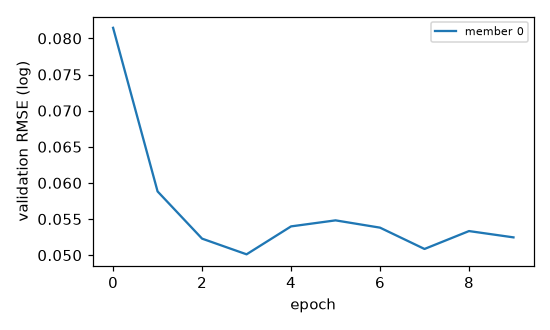
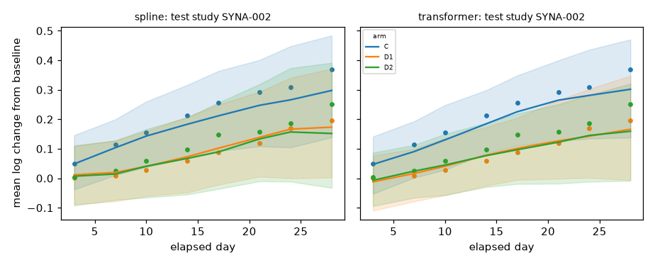

# send_bw report: v3_pilot_k0

> **REAL-DATA RUN - qualification stage must be checked before any use**

Body weight is the only modelled endpoint. Results cannot establish total animal requirements for a toxicology program, cannot justify reducing welfare observations or protocol checks, and are not regulatory-grade.

## Run provenance

- config: `runs/v3_pilot_k0k1/k0/effective.yaml` (hash `43575581e7be5616`), seed 20261024
- git revision: 9f1da17dcc52f22154364c9caf751a6601b78760
- software: matplotlib=3.11.2, numpy=2.5.4, pandas=3.1.0, platform=Linux-6.12.94+-x86_64-with-glibc2.39, pyarrow=26.0.0, pydantic=2.14.1, python=3.12.3, scikit-learn=1.9.1, scipy=1.18.1, torch=2.14.1

| stage | status | seconds | key |
|---|---|---|---|
| evaluate | NA | 0.9 | NA |
| ingest | NA | 0.6 | 2665b0bc959b5441 |
| optional_models | {'chronos2': 'not_run', 'deepar': 'not_run', 'tft': 'not_run'} | NA | NA |
| prepare | NA | 0.2 | 1b47cd92c654e0fe |
| train_spline | trained | 0.5 | fcacbb15a24f0616 |
| train_transformer | trained | 2.2 | 384899ff8cfde5a8 |

## Data ingestion and QC

- weights: 7855, animals: 894, quarantined/flagged records: 0, mapping version: example-send-0.1
- eligible animals: 722, modelling observations: 4437
- QC checks: {'all_obs_have_animal': True, 'arm_keys_resolved': True, 'finite_log_weights': True, 'n_quarantined_hard': 0, 'n_quarantined_soft': 0, 'one_baseline_per_animal_max': True, 'passed': True, 'positive_weights': True, 'sex_values': ['F', 'M'], 'unique_animal_keys': True, 'unique_obs_keys': True}

Exclusion counts (animals):

| reason | n |
|---|---|
| species_out_of_scope | 170 |
| too_few_post_baseline_obs | 3 |

Limitations recorded during ingestion:

- 3 weight(s) dated from SEND study day because BWDTC was partial (DATE_UNCERTAIN)
- 50 administration record(s) deviate from the planned regimen; models use planned regimens only, so outcomes include deviation effects

Mapping warnings by type: none

Frozen study-level splits: {'test': 3, 'test_compound_holdout': 1, 'train': 9, 'validation': 3} (hash `4797ef4589ea7e7f`); compound holdout: ['CMP02']

Target-species manifests (frozen before donors): train n=9 hash `cbdb10a6c2f1bfdf`; validation n=3 hash `509b5d25bd90188b`; test n=3 hash `04d76ef2e097f9ff`. Sharing: context_specific; donors selected: 0.

## Models

### spline

- ridge alpha 0.1 (validation-selected), train RMSE 0.0437, validation RMSE 0.0597, OOF RMSE 0.1589, 62 mean parameters, 7 study-bootstrap members
- covariance (OOF residual ML): ell=3.6072, sd_a0=0.0386, sd_a1=0.1081, sd_s0=0.0619, sd_s1=0.1028, sigma_m=0.0001, sigma_p=0.0379
- covariance fit: {'converged': True, 'message': 'CONVERGENCE: RELATIVE REDUCTION OF F <= FACTR*EPSMCH', 'n_animals': 420, 'n_obs': 2402, 'n_studies': 9, 'nll': -3824.16952875301, 'params_at_bound': ['sigma_m']}

### transformer

- architecture {'d_model': 32, 'dropout': 0.1, 'group_dims': {'baseline': 1, 'bio': 2, 'compound': 4, 'regimen': 5}, 'n_heads': 2, 'n_layers': 1, 'q_dim': 5} (custom baseline-conditioned transformer; NOT a TFT)
- members (study-bootstrap except member 0): m0: best val RMSE 0.0501 after 10 epochs (seed 20261024)
- covariance layer shared with the spline model (primary mean-function comparison)

### bayesian: not_run

### Optional models (not required benchmarks)

| model | status | task | reason |
|---|---|---|---|
| chronos2 | not_run | secondary (early-history, zero-shot first; fine-tuning separate) | disabled in config |
| deepar | not_run | secondary (early-history forecasting) | disabled in config |
| tft | not_run | secondary (early-history forecasting) | disabled in config |

## Held-out evaluation

### Primary task: pre-study prediction of new studies

| model | split | studies | obs | RMSE log | RMSE g | MAE g | cov80 | cov95 | CRPS | SB RMSE | SB cov95 | energy | grp-mean cov90 | contrast cov90 | contrast bias | var ratio | incr ratio | max cov90 |
|---|---|---|---|---|---|---|---|---|---|---|---|---|---|---|---|---|---|---|
| spline | test_compound_holdout | 1 | 389 | 0.164 | 74.705 | 58.877 | 0.990 | 1.000 | 0.100 | 0.164 | 1.000 | 0.318 | 1.000 | 1.000 | 0.242 | 2.745 | 4.816 | 1.000 |
| spline | test | 3 | 774 | 0.059 | 16.992 | 12.419 | 0.999 | 1.000 | 0.040 | 0.061 | 1.000 | 0.116 | 1.000 | 1.000 | -0.011 | 2.947 | 1.931 | 1.000 |
| transformer | test_compound_holdout | 1 | 389 | 0.052 | 14.384 | 10.856 | 0.997 | 1.000 | 0.036 | 0.052 | 1.000 | 0.116 | 1.000 | 0.750 | 0.066 | 2.799 | 1.649 | 1.000 |
| transformer | test | 3 | 774 | 0.057 | 17.190 | 12.400 | 0.997 | 1.000 | 0.038 | 0.054 | 1.000 | 0.107 | 1.000 | 1.000 | 0.041 | 2.990 | 1.798 | 1.000 |

SB = study-balanced. Coverage targets: cov80=0.80, cov95=0.95, group-mean/contrast/max cov90=0.90; variance and increment ratios target 1. Few test studies -> wide uncertainty.

Residual correlation by gap (observed vs predicted):

| model | split | gap_bin | corr_obs | corr_pred | n_pairs |
|---|---|---|---|---|---|
| spline | test_compound_holdout | (0,4] | 0.904 | 0.888 | 7 |
| spline | test_compound_holdout | (4,8] | 0.854 | 0.821 | 6 |
| spline | test_compound_holdout | (8,15] | 0.785 | 0.732 | 9 |
| spline | test_compound_holdout | (15,100] | 0.606 | 0.577 | 6 |
| spline | test | (0,4] | 0.901 | 0.878 | 14 |
| spline | test | (4,8] | 0.840 | 0.817 | 15 |
| spline | test | (8,15] | 0.749 | 0.725 | 20 |
| spline | test | (15,100] | 0.595 | 0.571 | 13 |
| transformer | test_compound_holdout | (0,4] | 0.904 | 0.889 | 7 |
| transformer | test_compound_holdout | (4,8] | 0.854 | 0.826 | 6 |
| transformer | test_compound_holdout | (8,15] | 0.785 | 0.753 | 9 |
| transformer | test_compound_holdout | (15,100] | 0.606 | 0.633 | 6 |
| transformer | test | (0,4] | 0.901 | 0.874 | 14 |
| transformer | test | (4,8] | 0.840 | 0.800 | 15 |
| transformer | test | (8,15] | 0.749 | 0.716 | 20 |
| transformer | test | (15,100] | 0.595 | 0.575 | 13 |

### Secondary task: early-history forecasting (kept separate)

(none)

Success on the secondary task does not establish success on the primary task.

## Experimental design

Design stage not run.

## Statistical assumptions not yet validated

- Pooled-sex analysis assumes a common treatment effect across sexes.
- The production default final analysis is endpoint ANCOVA. GLS is requestable and is not a default after locked synthetic diagnostics; it is not design qualification.
- GLS benefit from intermediate visits relies on the fixed quadratic group-difference basis; bias is only checked under the simulated mechanisms.
- The working covariance is a historical plug-in from training studies; model-based SEs with df = N_animals - (3 + G k) are an approximation (no Kenward-Roger).
- Missingness is simulated as MAR missed visits and non-informative dropout; informative termination is not addressed and no power claims are made for it.
- Spline/transformer parameter uncertainty comes from study bootstrap of the mean only; covariance parameter uncertainty is not propagated for those models.
- Synthetic generators are illustrative and not biologically validated.

